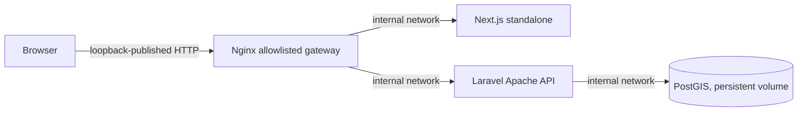

# Batch 044 Linux staging handoff

This is a reproducible staging foundation for an already provisioned, isolated Linux host. It is not a deployment record. The stack has not been built or started in this Termux session; no PostgreSQL connection, dataset import, public endpoint, or production system was accessed.

## Architecture and network boundary



Only Nginx publishes a host port, bound to `127.0.0.1`. The database and application services have no host ports, share an internal-only Compose network, and use bounded CPU, memory, process, and log settings. Use an SSH tunnel for an external browser session. The gateway rejects unknown `Host` values with status 444; `STAGING_ALLOWED_HOSTS` is a space-separated allowlist. The API is reachable only through that gateway.

The browser uses the same origin at `/api/v1`, so the staging CORS allowlist is empty by default and credentials are not enabled. Set `CORS_ALLOWED_ORIGINS` only for a reviewed separate origin. Laravel receives `APP_ENV=staging`, `APP_DEBUG=false`, and `BIYAHE_OFFLINE_WALKING_PREVIEW=false`. The development walking route remains unregistered outside the local environment. It must not be made public to support staging.

## Pinned runtime lines

The Compose stack uses PHP `8.3.35` on Debian Bookworm, PostgreSQL `16` with PostGIS `3.5`, Node.js `24.21.0`, Nginx `1.31.6-alpine3.24`, and Composer `2.8.12`. `web/package-lock.json` pins application dependencies and Playwright Test `1.64.0`. The Node runtime was moved off Node 20 because upstream marked Node 20 end-of-life on 2026-03-24; Node 24 is an LTS line. These exact image tags and workflow versions still need an external build and test before a staging deployment can be claimed. The PostGIS image currently documents x86-64 as its supported architecture; treat other architectures as unverified until exercised externally.

The API and web Dockerfiles build from checked-in lockfiles. The API image installs only production Composer dependencies. The Next.js image uses the standalone output. Startup does not run migrations, import datasets, rebuild the pedestrian graph, or enable the development adapter.

## External host setup

Use an external Linux x86-64 host. The selected PostGIS image currently publishes the required PostgreSQL 16/PostGIS 3.5 tag for x86-64; the bootstrap rejects other host architectures with a dependency status. Install Docker Engine with Compose v2, Bash, coreutils (`stat`, `mktemp`, `sha256sum`), Git, Python 3, PHP CLI only for key generation, OpenSSL, and PostgreSQL client tools (`pg_restore`). The container images provide PHP extensions and Node. Keep the checkout and secret files on encrypted or access-controlled storage. Do not copy a production environment file or credentials into the staging host.

From the repository root on the external host:

```sh
mkdir -m 700 -p deploy/staging/secrets
cp deploy/staging/.env.example deploy/staging/.env
chmod 600 deploy/staging/.env
umask 077
php -r 'echo "base64:".base64_encode(random_bytes(32));' > deploy/staging/secrets/app_key
openssl rand -hex 32 > deploy/staging/secrets/db_app_password
openssl rand -hex 32 > deploy/staging/secrets/db_admin_password
chmod 600 deploy/staging/secrets/*
```

Review `deploy/staging/.env` and set only nonsecret values: an unused loopback port, the staging `APP_URL`, and an exact `STAGING_ALLOWED_HOSTS` list. Credential values stay in secret files. The Compose configuration mounts them as Docker secrets; the root entrypoint copies them to a private tmpfs with `www-data` ownership, then drops privileges before starting Apache. Laravel reads only those runtime copies through `APP_KEY_FILE` and `DB_PASSWORD_FILE`. Do not use `docker compose config` output as a secret store.

Run the read-only host and configuration check, then inspect the proposed order:

```sh
api/scripts/staging-bootstrap.sh --preflight
api/scripts/staging-bootstrap.sh --dry-run
```

Starting Compose initializes the persistent Postgres volume if it is new, so service start itself requires an explicit flag:

```sh
api/scripts/staging-bootstrap.sh --start --confirm-staging-start
api/scripts/staging-bootstrap.sh --initialize-db --confirm-database-initialization
```

The first command starts services but applies no Laravel migration or reviewed transit import. The second idempotently creates PostGIS if needed, creates the app role only if absent, and grants database/schema access. It does not rotate an existing role password. If an app role already exists, verify its credential with the staging owner before proceeding.

## Backup, migrations, and dataset import

Before every schema or data change, create a PostgreSQL custom-format backup outside the repository. Do not overwrite an existing backup:

```sh
umask 077
set -o noclobber
docker compose --project-directory deploy/staging --env-file deploy/staging/.env \
  -f deploy/staging/compose.yaml exec -T db \
  pg_dump -U biyahe_admin -d biyahe_staging --format=custom > /secure/staging/biyahe-before-change.dump
sha256sum /secure/staging/biyahe-before-change.dump
pg_restore --list /secure/staging/biyahe-before-change.dump >/dev/null
```

Record the path and SHA256 in the nonsecret `BIYAHE_STAGING_BACKUP_FILE` and `BIYAHE_STAGING_BACKUP_SHA256` settings in the protected staging `.env`. The bootstrap refuses migrations/imports without a matching checksum and a readable custom-format dump. Preserve the backup hash with the release record.

Apply only reviewed forward migrations after a successful backup:

```sh
api/scripts/staging-bootstrap.sh --apply-migrations --confirm-staging-migrations
```

Inspect each pinned dataset before importing. Current expected SHA256 values are:

| Dataset | SHA256 |
|---|---|
| `cebu-central-network-2026-10-05.json` | `edb91e22f3a55b46f20a1faf3823d4bda0d2e48eb5d9ee4b06b1c724e3e9e6fe` |
| `cebu-network-expansion-2026-10-05.json` | `0b6ce82304689b6472d2835b2ef4b3da7b397560db846ba1f7cf1aa4866920d7` |

The dry-run validates the dataset and invokes the existing importer in dry-run mode without modifying the database:

```sh
api/scripts/staging-bootstrap.sh --dry-run-import cebu-central-network-2026-10-05.json
api/scripts/staging-bootstrap.sh --dry-run-import cebu-network-expansion-2026-10-05.json
```

An actual import requires the matching SHA256 confirmation and a valid backup:

```sh
api/scripts/staging-bootstrap.sh --import cebu-central-network-2026-10-05.json \
  --confirm-dataset edb91e22f3a55b46f20a1faf3823d4bda0d2e48eb5d9ee4b06b1c724e3e9e6fe
```

The importer is transactional and uses stable identifiers. Retain its validation, dry-run, applied record counts, and any failure output. On an import failure, do not rerun blindly: inspect the transaction result, verify the backup, and restore only under the staging owner’s change procedure. The two approved input files above are not proof of route, fare, boarding, access, or field safety.

For an approved staging rollback, the bootstrap verifies the configured custom-format backup hash, stops API and web writes, then restores in a single PostgreSQL transaction. Supply the same SHA256 in the explicit confirmation:

```sh
api/scripts/staging-bootstrap.sh --restore-backup \
  --confirm-staging-restore "$BIYAHE_STAGING_BACKUP_SHA256"
```

API and web stay stopped after restoration so the staging owner can inspect the database before restarting them. `--inspect-db` reports PostGIS, app-role presence, and PostgreSQL's approximate per-table row estimates from statistics; it does not scan application tables.

## Health and API smoke checks

After schema and approved data are ready, check `/up`, `/api/v1/health`, and `/api/v1/ready`. Then run the read-only machine smoke tool with a new evidence path:

```sh
python3 api/scripts/staging-api-smoke.py \
  --base-url http://127.0.0.1:8080 \
  --output /secure/staging/evidence/api-smoke-$(date -u +%Y%m%dT%H%M%SZ).json
```

The default run checks health, PostGIS, readiness, search response shape, invalid-input behavior, unknown-place handling, and that the development walking endpoint is not registered. Search results may be empty. No successful journey response is fabricated or required. For direct/transfer and Can-I-Ride response-contract checks, supply two real canonical place IDs and a route code or ID from this staging dataset. Output is no-clobber JSON with redacted response content and raw response hashes. `NOT_RUN` means the real data inputs were not supplied; `BLOCKED_DEPENDENCY` means the staging service could not be reached; neither is a pass.

## Frontend build and browser checks

From `web/` on the external Linux host:

```sh
npm ci
npm run typecheck
npm run lint
npm run build
npm run test:ride-mode
npm run test:commute-cards
npm run test:offline-walking-preview
npm run test:request-gate
npm run test:can-i-ride
npm run test:place-search
npm run test:search-keyboard
npm run test:ux
npx playwright install --with-deps chromium
```

Set `BIYAHE_STAGING_BASE_URL` to the loopback staging origin. For the data-dependent journey flow, set `BIYAHE_E2E_ORIGIN_QUERY` and `BIYAHE_E2E_DESTINATION_QUERY` to canonical place queries actually present in staging. Then run `npm run test:browser`. Playwright executes one Chromium worker at 320, 360, and 390 CSS pixels. The shell/error/keyboard checks run without fabricated success data; save, reopen-offline, and manual Ride Mode require a real route from the selected staging data and are skipped if the operator has not supplied those inputs or the planner returns no route. Browser tests do not enable local graph preview in staging.

The test artifacts include screenshots, trace, video on failure, and the HTML report under `web/test-results/` and `web/playwright-report/`. Keep those outside any public static directory. No browser test was run during Batch 044 because this Termux environment has no staging origin or browser installation.

## Portable corpus replay and manual CI

The Batch 044 portable kit accepts an explicit graph path and still enforces the fixed five-sample preflight, first-breach cancellation, 262144 KiB process-tree RSS cap, expected graph SHA256, read-only SQLite `quick_check(1)`, and read-only Laravel graph connection. Use a unique evidence root on the external Linux host:

```sh
bash docs/portable-verification-v6/verify-kit.sh --mode CORPUS \
  --graph-path /srv/biyahe/cebu-walk-central-visayas-20261007-v3.sqlite \
  --output-root /srv/biyahe/evidence/batch044-corpus
```

Select a bounded subset with `--corpus-cases 0,3`; only a matching run of all ten cases can establish full replay. The full graph replay is also available through the manual `External Cebu graph corpus` workflow on a separately configured self-hosted Linux runner. It is not triggered by push or pull request. Do not copy or modify the graph to satisfy a path expectation. This Termux session did not access or replay the graph.

## Shutdown, rollback, and release gates

Stop containers without deleting the persistent database volume:

```sh
api/scripts/staging-bootstrap.sh --shutdown --confirm-staging-shutdown
```

For rollback, point the staging deployment back to the prior image/revision and retain the failed release’s logs. Migrations are forward-only here; do not use `migrate:fresh` or speculative down migrations against persistent staging. Restore the verified custom dump only after staging writes are stopped and the owner has approved the restore.

Successful Compose parsing, builds, API smoke, browser tests, and graph replay are separate evidence. None of those establishes field transfer safety, live production graph integration, or private-beta readiness. Production activation remains `NO`; private beta remains blocked until its independent evidence review.
